# Neuroimaging (ADNI Brain MRI) Using ConvNeXt
**Author:** Lawrence Tiang  
**Student ID:** s4892210  
**Course:** COMP3710 – Pattern Analysis (2026)  
**Implementation Difficulty:** Hard


## 1. Project Overview
### 1.1 Problem & Motivation
Research shows that as of 2026, approximately 40 million people worldwide are living with Alzheimer's Disease with this number expecting to triple by 2050 [1]. Alzheimer's Disease is a progressive neurodegenerative disease that can affect a person's ability to perform everyday activities by gradually impairing their memory and cognitive functions. It is characterised by structural changes in the brain, including hippocampal and cortical atrophy with ventrivular enlargement. This project investigates automated classification of T1-weighted structural brain MRI scans into Alzheimer's Disease (AD) and Normal Cognitive (NC) classes to support earlier screening. Early detection is important because identifying potential signs of AD can enable timely diagnois and early intervention. However, it is challenging to accurately discriminate AD from NC due to natural variations in brain structure, head shape and patient age.

### 1.2 Proposed Algorithm
For this project I used a ConvNeXt model to help distinguish Alzheimer's Disease (AD) from Normal Cognitive (NC) cases. ConvNeXt is a modern convolutional neural network (CNN) architecture introduced in the paper "A ConvNet for the 2020s" by Facebook AI Research in 2022 [2]. The model combines the strengths of traditional CNN architectures with modern design improvements to achieve strong performance on image classification tasks while maintaining computational efficiency and scalability [3]. Specifically, results from the original paper show ConvNeXt outperforming ResNet and Vision Transformers by combining design concepts such as depthwise convolutions, layer normalisation, GELU activation functions and residual connections. Its hierarchical architecture allows the model to progressively learn increasingly complex features from the input MRI images. This is particularly useful for this classification problem because the anatomical differences between AD and NC scans can be subtle, requiring the model to capture both local and global brain patterns.

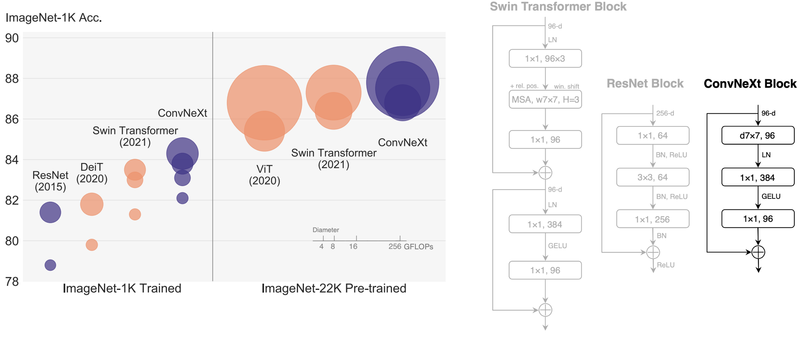


### 1.3 How It Works
To systematically train and evaluate the ConvNeXt model I will follow the machine learning pipeline to ensure a clear workflow. As a general overview, the pipeline begins with the ADNI dataset which contains the brain MRI images labelled as either AD or NC. I first separate the dataset into training, validation and testing sets using patient-level splitting. Then I preprocessed the images by resizing them, converting the greyscale to three channels and normalising their pixel intensities. For the training set I applied additional data augmentation, including random cropping, horizontal flipping, rotation, ColorJitter, affine transformations, RandAugment and random erasing. The processed images are passed through the ConvNeXt model training loop to produce predictions for the AD and NC classes. After each epoch, the model is evaluated on the validation set and the checkpoint with the lowest validation loss is saved as the best model. Once training is complete the best model is evaluated on the test set to assess its final classification performance.

I also compared ConvNeXt against a baseline CNN to determine whether the additional complexity is beneficial. The baseline model consists of five convolutional blocks followed by global averge pooling, dropout and a linear classification layer. Both models are evaluated using accuracy, F1-score, AUROC, precision, recall and computational costs.

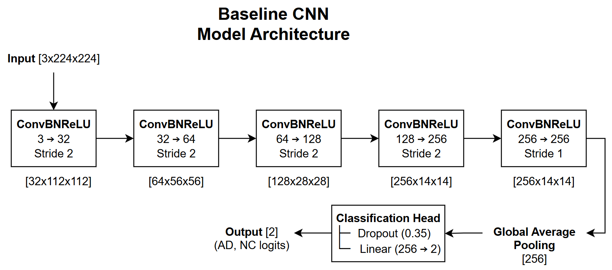  

### 1.4 High-level Visualisation
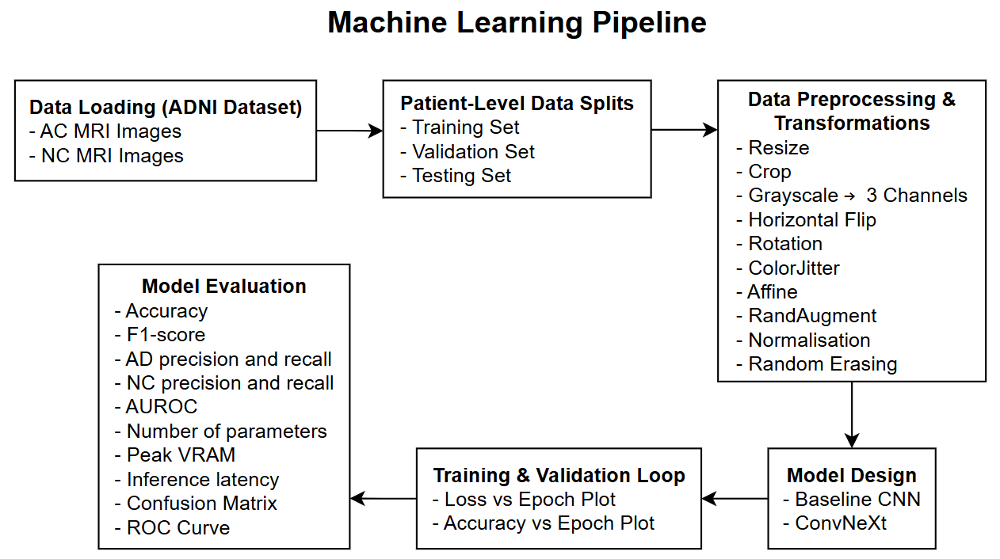  


## 2. Feasibility Review
### 2.1 User Need, Scope & Acceptance Criteria
#### Intended Users
1. **Medical Professionals:** Uses the prototype as a support tool to assist in identifying potential AD cases from MRI images.
2. **Medical Researchers:** Uses the prototype to investigate the reliability of automated AD classification and assess the confidence.
3. **Machine Learning Researchers:** Uses the prototype and report to evaluate the ConvNeXt architecture and performance for medical image classification.

#### Prototype Purpose  
It is important to note that the prototype is not intended or approved for clinical diagnois. Instead its primary purpose is to act as a research tool for investigating whether the ConvNeXt model can effectively classify AD from structural brain MRI images. Due to the complexity and variability of MRI images, it can be difficult to manually identify disease related patterns. As such, the prototype can help automate the process by accepting high confidence predictions and routing low confidence ones for further human review. This improves the efficiency of the classification process so that medical professionals can spend more time analysing complex cases.

#### Acceptance Criteria
1. Achieve a minimum test accuracy of 0.80 to demonstrate useful discrimination between Alzheimer’s disease (AD) and normal cognitive (NC) cases.
2. Achieves higher or comparable classification performance to the baseline CNN on the test set.
3. The training and evaluation pipeline runs successfully on the Rangpur HPC cluster with peak VRAM and inference latency recorded to assess computational resource requirements.
4. The final system must produce reproducible evaluation results on the test set and complete within the available 12 hour Rangpur HPC training limit.

### 2.2 Model Choice & Course Concepts
#### Proposed Dataset Configuration
```
ADNI/AD_NC/
├── test/  
│   ├── AD/
│   │   ├── <patient_id>_<segment_id>.jpeg
│   │   └── ... 
│   └── NC/
│       ├── <patient_id>_<segment_id>.jpeg
│       └── ... 
└── train/
    ├── AD/
    │   ├── <patient_id>_<segment_id>.jpeg
    │   └── ... 
    └── NC/
        ├── <patient_id>_<segment_id>.jpeg
        └── ... 
```
For this project we use the ADNI dataset which is located on the Ranpur HPC cluster at `/home/groups/comp3710/ADNI/AD_NC`. Each image is stored as a JPEG and represents a 2D greyscale slice from a T1-weighted brain MRI scan. Therefore, there can be multiple images corresponding to a single patient in the dataset. The images are classified into two binary classes, noteably Alzheimer's Disease (AD) and Normal Cognitive (NC). The provided `train/` and `test/` directories form the initial training and testing split. In total, the training set contains 21,520 images and the testing set contains 9,000 images. I will perform a further data split on the training set to create a separate validation subset for model evaluation. I will then apply a series of data preprocessing techniques and transformations to appropriately prepare the images for the experiment. Further details of data splitting, preprocessing and transformations are discussed in [Section 4](#4-data-preprocessing).

#### ConvNeXt Model Architecture
The original paper introduced multiple variants of the ConvNeXt model such as ConvNeXt-Tiny, ConvNeXt-Small and ConvNeXt-Base. ConvNeXt-Tiny is the smallest variant in the ConvNeXt family comprising a total of 18 ConvNeXt blocks distributed over four stages with depths of `[3, 3, 9, 3]`. I chose to use ConvNeXt-Tiny for the project as its relatively lightweight architecture makes it practical to train within the available computational budget. The official ConvNeXt implementation on GitHub served as a reference for implementing the ConvNeXt-Tiny model architecture [4].

**Input Layer**  
I applied the appropriate data preprocessing and transformations to the training set to prepare the images for model training. The resulting input images have dimensions of `3 x 224 x 224` (channels x height x width).

**Patchify Stem**  
ConvNeXt-Tiny starts with a patchify stem that reduces the spatial dimensions of the input images by a factor of four (`224 x 244 → 56 x 56`) and increases the channel dimension to `96`. It achieves this by applying a `4 x 4` convolutional layer with stride `4`. This operation transforms local regions of the input images into feature representations that subsequent stages can use to learn increasingly complex patterns. Layer Normalisation is then applied to stabilise the features before they are passed to the next stage.

**ConvNeXt Blocks**  
At each stage, ConvNeXt blocks are used to extract and refine features. Each block uses a `7 x 7` depthwise convolution with a large receptive field to efficiently capture local spatial context. Layer Normalisation is then applied to stabilise the feature distribution. Next, the block uses an inverted bottleneck structure consisting of two `1 x 1` pointwise convolutions. A GELU activation is applied inbetween the pointwise convolutions to introduce non-linearity. The pointwise convolutions expand the channel dimensions by a factor of four before projecting it back to its original size. A residual connection then adds the input to its transformed output which improved convergence and helps gradients flow through the network. Additionally, layer scaling is initialised to `1e-6` to help stablise training. Stochastic depth with a drop path rate of `0.1` is also used to improve regularisation by randomly dropping residual branches during training.

**ConvNeXt Stages & Downsampling**  
The ConvNeXt blocks are organised into four hierachical stages with depths `[3, 3, 9, 3]` that progressively extract more complex features. Between each stage, Layer Normalisation is applied before a `2 x 2` convolutional downsampling layer with stride 2 reduces the spatial dimensions and increases the number of channels. For a `224 x 224` input, the spatial dimensions progress through `[56 x 56 → 28 x 28 → 14 x 14 → 7 x 7]` and channel dimensions increase through `[96 → 192 → 384 → 768]`. This allows ConvNeXt-Tiny to learn features at different spatial scales.

- **Stage 1 (96 x 56 × 56):** Extracts low level features such as edges, textures and basic anatomical boundaries.
- **Stage 2 (192 x 28 × 28):** Combines low level features to identify more structured patterns such as tissue boundaries and local brain structure.
- **Stage 3 (384 x 14 × 14):** Learns more complex anatomical features and spatial relationships.
- **Stage 4 (768 x 7 × 7):** Extracts high level representations of brain anatomy.

**Global Average Pooling & Classification Head**  
Following the last stage, a global average pooling layer converts the `768 x 7 x 7` feature map into a `768` dimensional feature vector. This aggregates the learned spatial features before they are passed to the classification head. Layer Normalisation is applied before a linear layer maps the `768` dimensional feature vector to two output logits (AD and NC) for binary classification.

|  | 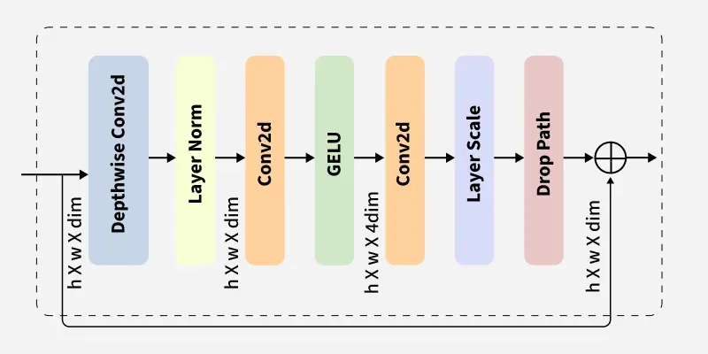 |
|---|---|


### 2.3 Preliminary Feasibility Evidence
#### Initial Data Audit
My initial audit confirmed that the dataset contains 30,520 JPEG images across the AD and NC classes. I inspected samples from both classes below to verify that the images were greyscale MRI slices and that they could be successfully loaded using my dataloader. Additionally, I found that the dataset has a relatively balanced class distribution of 48.69% AD (14,860 images) and 51.31% NC (15,660 images). This reduces the chance that ConvNeXt will be biased towards one class during training. Hence, I decided that implementing class weighting was not necessary for this project. Furthermore, I found that the images have a dimension of 256 by 240 pixels. This finding justifies my later preprocessing decision to resize the images to 224 x 224 pixels to match the commonly used input dimensions for ConvNeXt models.

| Alzheimer's Disease (AD) Sample      | Normal Cognitive (NC) Sample         |
|--------------------------------------|--------------------------------------|
| 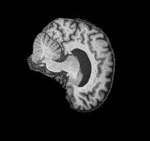 | 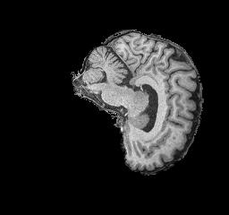 |

#### Baseline Smoke Test & Resource Estimate
Before commiting to a full training loop, I first ran a baseline smoke test using 10 epochs. On average the training process took approximately 87 seconds per epoch. Based on this result, I estimated that the planned training configuration could easily run for over 400 epochs within the Rangpur HPC runtime limit. It is recommended that training is performed on a GPU because ConvNeXt is a deep learning model that may require a large amount of computational resources. A GPU can help significantly reduce the training time by efficiently performing tensor operations in parallel. Additionally, I recommend using at least two CPU cores because my dataloaders are configured by default to use two workers for loading and preprocessing images. The baseline smoke test used approximately 3.0 GB of peak GPU VRAM. This only represents 7.5% of the available 40 GB of GPU memory on the Rangpur HPC cluster. I also measured roughly 0.4 ms/image for the expected inference latency using batched GPU inference. This is a reasonable computational cost and further supports the feasibility of the model architecture on the avaiable hardware.

### 2.4 Risks, Budget & Fallback
#### Technical Risks
1. **Overfitting:** ConvNeXt model may perform well on the training data but generalise poorly for the test data.
2. **Data Leakage:** Images from the same patient may appear across the training and validation sets.
3. **Insufficient Training Data:** The available ADNI dataset may not fully capture the variation between AD and NC cases.
4. **Generalisation:** ConvNeXt model may perform poorly on MRI data from different patients.
5. **Computational Limitations:** Training ConvNeXt for many epochs requires significant computational resources.
6. **Overconfident Predictions:** ConvNeXt model may be highly confident when making incorrect predictions.
7. **Class Specific Errors:** One class is favoured by the model and produces an unacceptably high false-negative rate for AD.

#### Computing Budget
- **GPU:** 1 x NVIDIA A100 GPU for model training and inference
- **GPU Memory:** 40 GB of available VRAM
- **CPU:** 2 CPU cores for the dataloader workers
- **Maximum Runtime:** 12 hours per slurm job as set by the Rangpur HPC cluster

#### Next Planned Experiment
My next planned experiment is to train the full ConvNeXt model for 300 epochs using the configuration that I validated during the baseline smoke test. This is the most useful next step because it allows me to evaluate the model's performance and determine if it can effectively classify AD from MRI images. In the scenario that the 300 epoch experiment exceeds the 12 hour runtime limit, I will reduce the number of epochs based on the measured training time. Furthermore, I will have to tune the hyperparameters if ConvNeXt does not provide a meaningful improvement over the baseline model. A checkpoint of the best performing model will be kept so that subsequent evaluation can be easily performed on the testing set.


## 3. Dependencies and Reproducibility
### 3.1 Software Requirements
| Packages     | Version |
|--------------|---------|
| Python       | 3.11.15 |
| Matplotlib   | 3.11.1  |
| NumPy        | 2.4.6   |
| Pillow       | 12.3.0  |
| scikit-learn | 1.9.0   |
| PyTorch      | 2.13.0  |
| torchvision  | 0.28.0  |

### 3.2 Reproducing Results
I used a fixed random seed of `42` to ensure reproducibility of results for all experiments. The specified model configuration, training hyperparameters and steps below provide the information required to reproduce the reported results.

1. Clone the repository onto the local machine and navigate to the `recognition/ConvNeXt_s4892210` directory.
2. Activate the provided Python environment and install all required dependencies.
3. Run `python utils.py` to calculate and verify the dataset normalisation statistics used by the training pipeline.
4. Run `python train.py --model baseline` to train the baseline CNN.
5. Run `python train.py --model convnext` to train the ConvNeXt model.
6. Run `python predict.py` to evaluate the performance of trained models on the test set.

**Outputs:** Model checkpoints, training curves, evaluation results and other generated outputs are saved in the `assets` directory.

```
recognition/ConvNeXt_s4892210/
├── assets/
│   ├── ad_sample.jpeg
│   ├── baseline_confusion_matrix.png
│   ├── baseline_model_architecture.png
│   ├── convnext_accuracy_vs_confidence.png
│   ├── convnext_accuracy.png
│   ├── convnext_block_architecture.png
│   ├── convnext_comparison.png
│   ├── convnext_confusion_matrix.png
│   ├── convnext_correct_predictions.png
│   ├── convnext_failure_predictions.png
│   ├── convnext_loss.png
│   ├── convnext_model_architecture.png
│   ├── convnext_roc_curve.png
│   ├── convnext_trial_accuracy1.png
│   ├── convnext_trial_accuracy2.png
│   ├── convnext_trial_accuracy3.png
│   ├── convnext_trial_loss1.png
│   ├── convnext_trail_loss2.png
│   ├── convnext_trail_loss3.png
│   ├── nc_sample.jpeg
│   └── pipeline.png
├── outputs/
│   ├── predict.out
│   ├── trainbase.out
│   └── trainconvnext.out
├── dataset.py
├── modules.py
├── predict.py
├── README.md
├── train.py
└── utils.py
```


## 4. Data Preprocessing
### 4.1 Training, Validation & Testing Splits
The provided ADNI dataset was already divided into `train/` and `test/` directories that formed the initial training and testing split. I further divided the training set into training and validation subsets using a common `90:10` split at the patient level [5]. The training subset is used to traing the models while the validation subset is important for tuning hyperparameters. The split was performed randomly using `train_test_split` with a random state of `42` for reproducibility. Note that I did not explicity preserve class proportions during splitting as we found the class distribution to be relatively balanced during the initial data audit. Consequently, the class distribution may vary slightly across the training, validation and testing sets. I specifically performed patient level splitting to prevent data leakage between the training and validation sets. Therefore, all brain MRI slices associated with the same patients were assigned exclusively to either the training or validation subset. The testing set was kept separate and reserved only for final model evaluation.

| Splits     | Total Images | AD Images | NC Images | Total Patients | AD Patients | NC Patients |
|------------|--------------|-----------|-----------|----------------|-------------|-------------|
| Training   | 19,360       | 9,480     | 9,880     | 968            | 474         | 494         |
| Validation | 2,160        | 920       | 1,240     | 108            | 46          | 62          |
| Testing    | 9,000        | 4,460     | 4,540     | 450            | 223         | 227         |

### 4.2 Data Transformations
A series of data preprocessing techniques were applied to appropriately prepare the images for the baseline CNN and ConvNeXt-Tiny model. I started by resizing all MRI images to 224 x 224 pixels and converting them from greyscale to three channels. These preprocessing steps ensure that the images match the suggested input dimensions of both models. Furthermore, I converted pixel intensities to tensors and normalised the images to standardise the input values for model training.

$$
x_{\text{norm}} = \frac{x - \mu}{\sigma}
$$
- $x$: Original pixel intensity
- $μ$: Training set mean (0.115540)
- $σ$: Training set standard deviation (0.225449)

I also performed data augmentation to introduce variation and improve generalisation. Augmentation was only applied to the training set and not the validation or testing sets. This is to ensure consistent model evaluation on unaugmented images.
- **Random Crop:** Randomly crops a portion of the image to simulate different MRI scan frames and positions.
- **Random Horizontal Flip:** Randomly flips images horizontally so models are less dependent on feature orientation.
- **Random Rotation:** Rotates images to represent small differences in brain orientation.
- **ColorJitter:** Randomly adjusts brightness and contrast to improve robustness to noise and inconsistencies in MRI scans.
- **Random Affine:**  Translate images to simulate small differences in image alignment and positioning.
- **RandAugment:** Applies a set of randomly selected augmentation operations to increase training diversity.
- **Random Erasing:** Randomly obscure a region of the image to encourage models to learn generalisable features.


## 5. Experimental Runs
### 5.1 Failed Experimental Runs
After finalising the ConvNeXt-Tiny model architecture and setting the initial hyperparameters, I conducted multiple experiments. I progressively refined the data augmentation strategies and tuned hyperparameters based on the evaluation results from each experiment. In the following sections, I talk about the major experimental milestones and key findings from each stage.

#### Experiment Milestone 1 (50% Accuracy Threshold)
Following relevant implementation guides, I selected the initial hyperparameters based on recommended starting values for image classification tasks [6]. However, my first experimental run achieved a test accuracy of 52.60% which fell below my expectations and the project's acceptance criteria. The loss plot clearly shows that the model learned very little after the first 10 epochs with the loss seemingly plateauing between 0.69 and 0.70. An interesting problem I noticed was that the learning rate became `NaN` after approximately 40 epochs. This suggests numerical instability during optimisation that was potentially caused by excessively large parameter updates from the high learning rate of `0.1`. Subsequently, the accuracy plot plateaus after 40 epochs at approximately 51.75% accuracy. There are significant signs of underfitting as the model struggles to learn discriminative features from the training data. The near random classification accuracy indicates that the initial training setup was ineffective. Therefore, in subsequent training runs I lowered the learning rate and experimented with stronger data augmentation to improve model convergence.

| Metrics      | Value  |
|--------------|--------|
| Accuracy     | 0.5260 |
| F1-Score     | 0.5254 |
| AUROC        | 0.5362 |
| AD Precision | 0.5230 |
| AD Recall    | 0.4939 |
| NC Precision | 0.5286 |
| NC Recall    | 0.5575 |

| 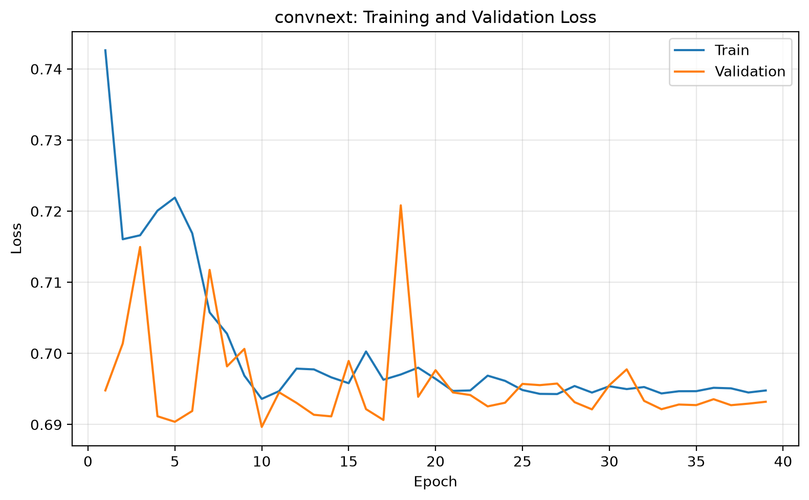 | 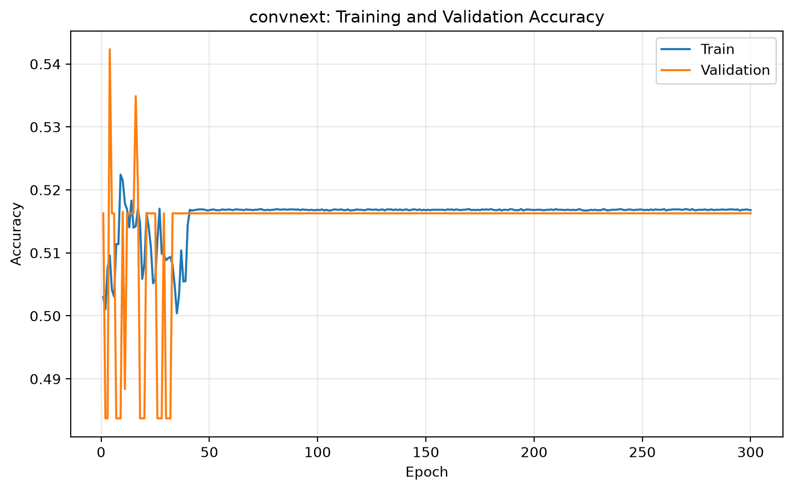 |
|---|---|

#### Experiment Milestone 2 (60% Accuracy Threshold)
After reducing the learning rate to `1e-2` and refining the data augmentation pipeline, I achieved my second milestone of 61.51% test accuracy. Nevertheless, I continued to encounter the same `NaN` problem outlined in Milestone 1. From the loss plot, we can observe that the loss still fluctuates around 0.69 before dropping significant near epoch 150. This corresponds to a spike in the accuracy plot where both training and validation accuracy increased to approximately 60%. However, this improvement was temporary as accuracy quickly dropped back to around 51.75%. Overall, the model continued to show signs of underfitting as the model struggles to reliably distinguish between AD and NC samples. To address the persistent `NaN` issue in future experiments, I conducted conduct further research into optimisation stability and hyperparameter selection [7]. Based on my findings, I further reduced the learning rate and lowered the weight decay from its initial value of `0.05` to investigate whether these adjustments would improve training stability. 

| Metrics      | Value  |
|--------------|--------|
| Accuracy     | 0.6151 |
| F1-Score     | 0.6151 |
| AUROC        | 0.6361 |
| AD Precision | 0.6103 |
| AD Recall    | 0.6179 |
| NC Precision | 0.6200 |
| NC Recall    | 0.6123 |

| 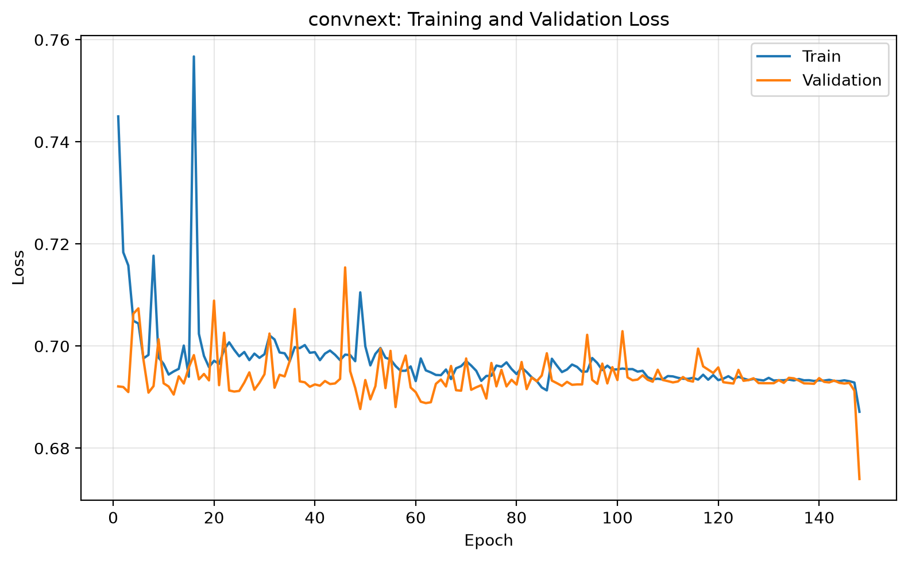 | 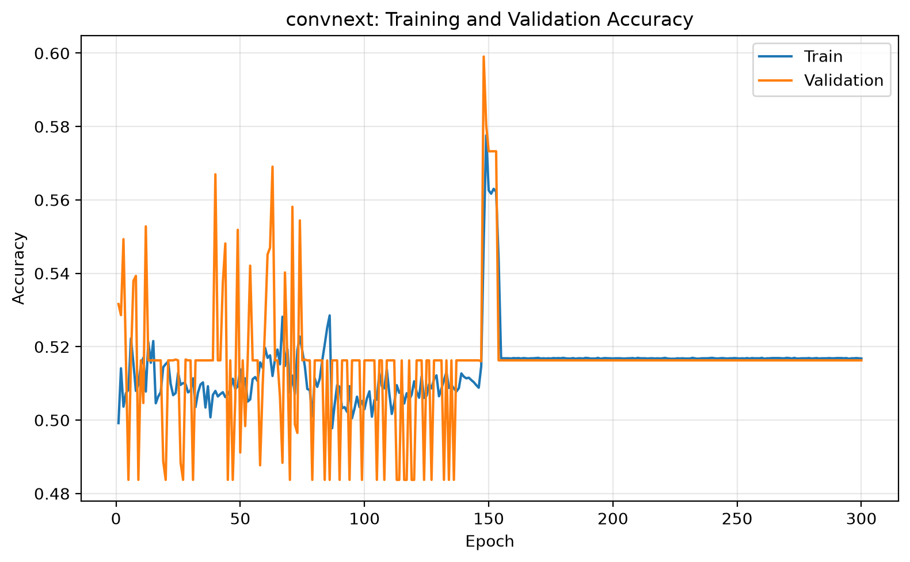 |
|---|---|

#### Experiment Milestone 3 (70% Accuracy Threshold)
Milestone 3 was more challenging to achieve as I initially struggled to surpas 70% test accuracy. As suggested in Milestone 2, I reduced the learning rate to `1e-3` and lowered the weight decay to `0.01`. These changes resolved the `NaN` problem and resulted in more stable training as demonstrated by the loss and accuracy plots. Additionally, I introduced label smoothing with a value of `0.1` to regularise model predictions and adjusted the data augmentation parameters to improve generalisation. Together these changes resulted in a test accuracy of 74.52%.

While previous milestones showed signs of underfitting, Milestone 3 suggests potential overfitting as there is a noticeable generalisation gap between the training and test accuracy. Although the model's ability to classify AD and NC samples has improved, its performance on unseen data remains still limited. So far, I have selected the best model for evaluation based on the highest validation accuracy achieved during training. However, for my next experiment I plan to follow an interesting PyTorch forum discussion that suggested to select the model with the lowest validation loss [8]. This approach may improve generalisation as validation loss also accounts for prediction confidence whereas accuracy only measures the proportion of correct classifications.

| Metrics      | Value  |
|--------------|--------|
| Accuracy     | 0.7452 |
| F1-Score     | 0.7337 |
| AUROC        | 0.8532 |
| AD Precision | 0.9060 |
| AD Recall    | 0.5422 |
| NC Precision | 0.6775 |
| NC Recall    | 0.9447 |

| 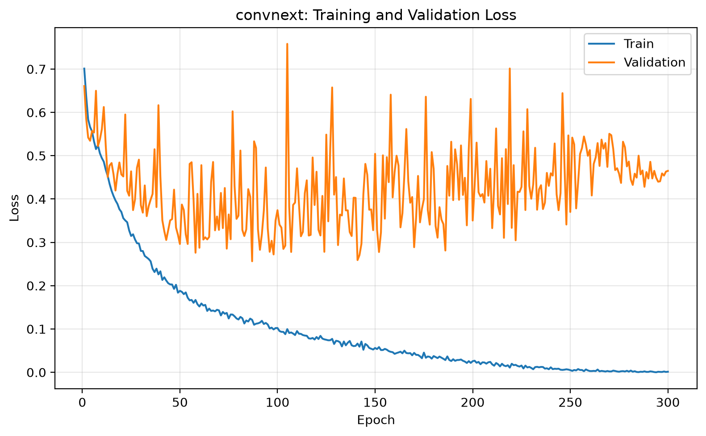 | 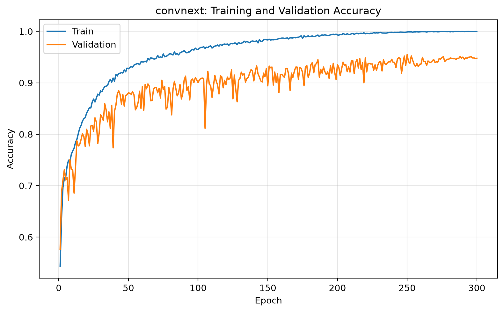 |
|---|---|

### 5.2 Final Experimental Configuration
The best model to use for evaluation was chosen based on the lowest validation loss achieved during training. I also increased the number of training epochs to `400` to allow ConvNeXt-Tiny more opportunities to learn discriminative features.  
I selected `AdamW` because it is a widely adopted optimisation algorithm in modern machine learning. It provides adaptive learning rate updates while also decoupling weight decay from gradient updates [9].  
Meanwhile, `Cross Entropy Loss` with label smoothing was selected as the loss function because it is well suited for binary classification tasks. It allows the model to distinguish between two output classes (AC and NC) based on their logits.

$$
L = -\frac{1}{N}\sum_{i=1}^{N}\sum_{c=1}^{C} p_{i,c}(x)\log q_{i,c}(x)
$$
- $N$: Number of samples
- $C$: Number of classes
- $p_{i,c}$: Target probability for class
- $q_{i,c}$: Predicted probability for class

| Parameters              | Value               |
|-------------------------|---------------------|
| Number of Epochs        | 400                 |
| Batch Size              | 256                 |
| Learning Rate           | 1e-3                |
| Weight Decay            | 0.01                |
| Optimiser               | AdamW               |
| Loss Function           | Cross Entropy Loss  |
| Learning-rate Scheduler | Cosine Annealing LR |
| Random Seed             | 42                  |


## 6. ConvNeXt Final Results: Visualisation & Analysis
### 6.1 Training Performance
| 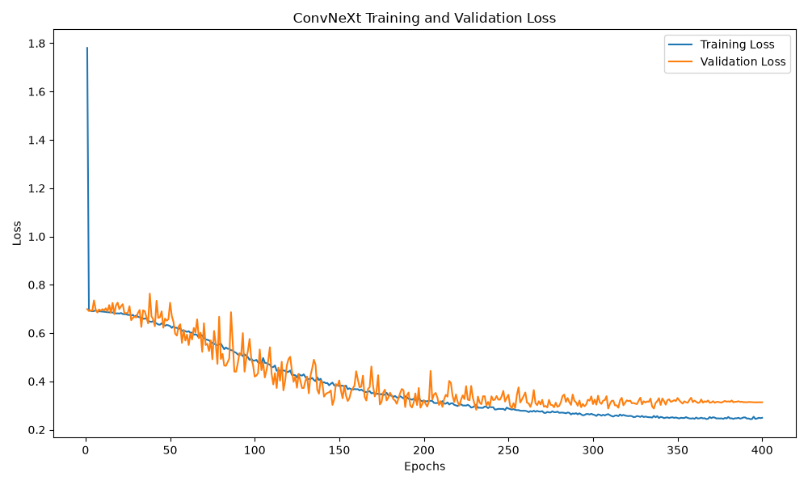 | 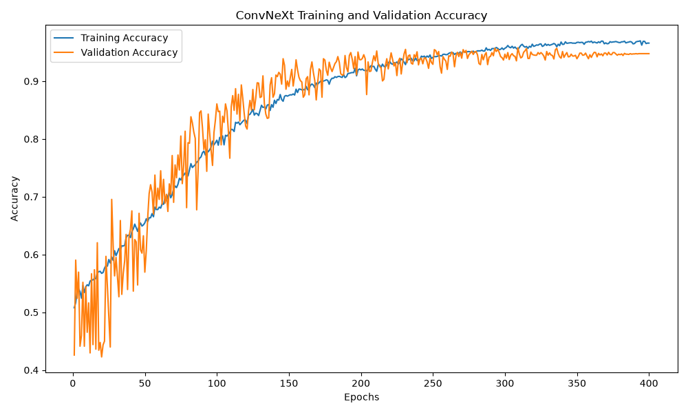 |
|---|---|

After 400 epochs of training, we can see from the loss plot that the ConvNeXt-Tiny model learns useful features early on as the training loss quickly drops to around 0.7. The model continues to progressively learn as we observe a downwards trend for both training and validation loss. However, the smoother training loss curve suggests that the model is optimising more consistently on the training data. Fluctuations in validation loss may be cause by variations in the validation samples or the model's sensitivity to unseen data. After approximately 200 to 250 epochs the model seems to approach convergence as the loss begins to stablise. The relatively small generalisation gap between training and validation loss suggests that the model generalies reasonably well to unseen samples. However, in later epochs we witness signs of mild overfitting as the training loss continues to decrease while validation loss plateaus.

For the accuracy plot, we notice that the training accuracy starts at approximately 50% while the validation accuracy fluctuates substantially during the earlier epochs. Nevertheless, there is a clear upwards trend that indicates the model is effectively improving at classifying AD and NC samples. The improvements are especially evident in the early stages as we see the accuracy significantly increase. After approximately 200 epochs we also observe the validation accuracy begin to stabilise. The model has strong classification performance as both training and validation accuracy comfortably achieve above 90% in the later stages. However, the model shows potential signs of overfitting as there is a clear generalisation gap between the training and validation accuracy. Furthermore, there may be diminishing returns after 250 epochs since accuracy improvements become increasingly small.

Overall, the ConvNeXt-Tiny model performed best at epoch 231 with a validation loss of 0.2823 and validation accuracy of 95.51%. The relatively early convergence suggests that the model learned effective feature representations without requiring the full 400 epoch training duration. The remaining epochs provided limited improvement in validation performance so future improvements may also consider reducing the number of epochs.

### 6.2 Classification Performance
| 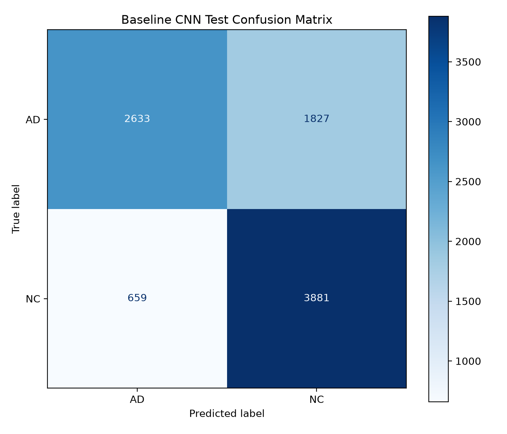 |  |
|---|---|

Comparing the confusion matrices, we can clearly observe that the ConvNeXt-Tiny model correctly classifies more AD and NC samples than the Baseline CNN model. In particular, ConvNeXt-Tiny correctly classified 73 additional AD samples which corresponds to a 2.77% improvement over the Baseline CNN model. Although this improvement may seem small, accurately identifying AD cases is important because misclassifying an AD patient as NC could delay treatment and potentially endanger their lives. Furthermore, ConvNeXt-Tiny correctly classified 477 additional NC samples which corresponds to a 12.29% increase. This improvement may help reduce false-positive classifications which could otherwise cause unnecessary stress for patients and create more work for medical professionals. However, there is still room for development as ConvNeXt-Tiny appears to be more effective at identifying NC cases than AC cases. Future improvements could be aimed at further reducing the false-negative rate to support more reliable classification.

These findings are further supported by the ROC curve below which illustrates ConvNeXt-Tiny's ability to separate AC and NC cases across different classification thresholds. The model achieves an AUROC of 0.8628 which indicates strong discriminatory performance compared to the random classifier.

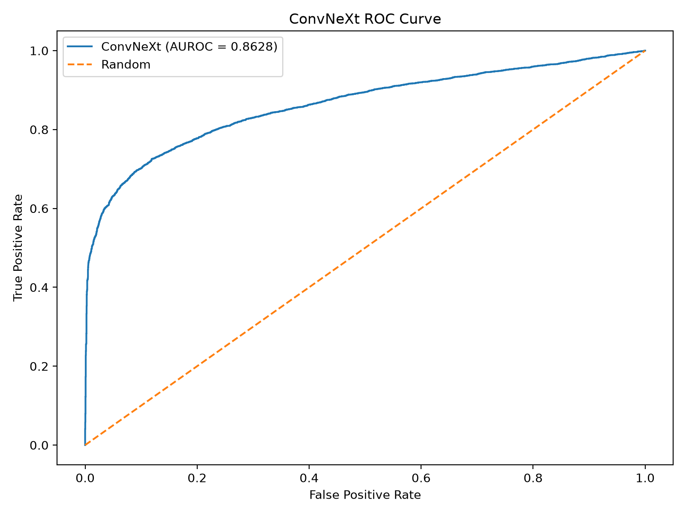  

### 6.3 Correct Predictions Across Different Confidence Levels
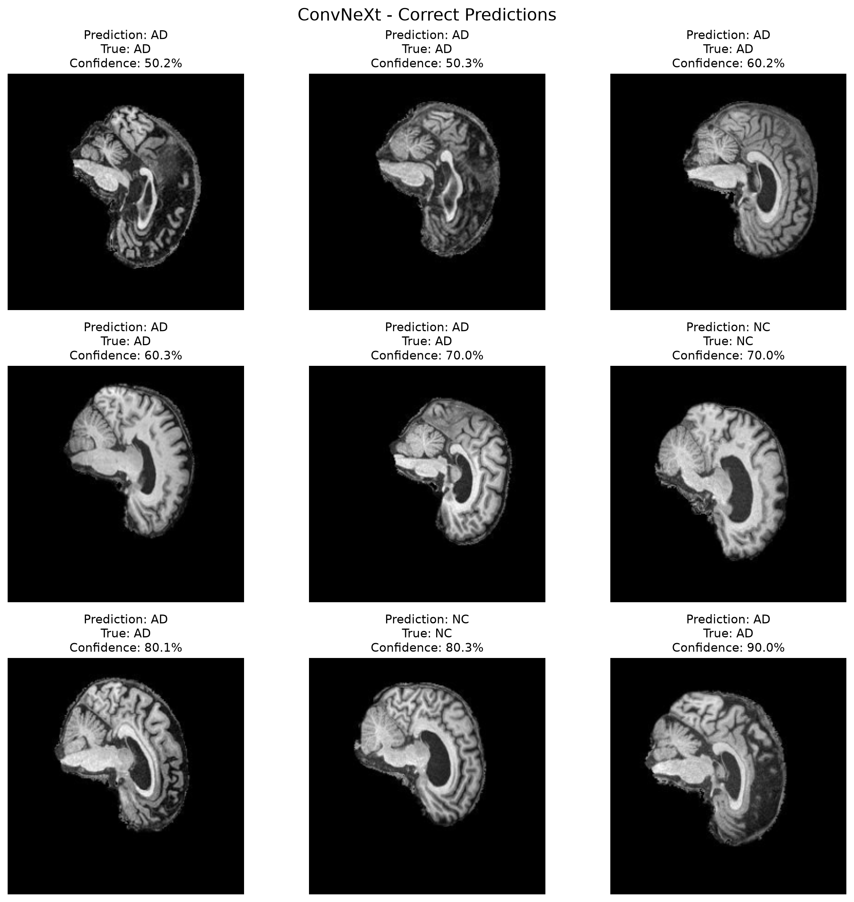  


## 7. Open Research Dilemma Investigation
### 7.1 Quantitative Benchmarking
| Metrics      | Baseline | ConvNeXt |
|--------------|----------|----------|
| Accuracy     | 0.7238   | 0.7849   |
| F1-Score     | 0.7184   | 0.7774   |
| AUROC        | 0.8098   | 0.8628   |
| AD Precision | 0.7998   | 0.9370   |
| AD Recall    | 0.5904   | 0.6067   |
| NC Precision | 0.6799   | 0.7130   |
| NC Recall    | 0.8548   | 0.9599   |

ConvNeXt-Tiny achieved a high test accuracy of 78.49%. Yet this still falls short of the 80% test accuracy defined by the project's acceptance criteria. This suggests that further optimisation is required to meet the target with future improvements potentially focusing on more systematic hyperparameter tuning and refined data augmentation strategies. However, ConvNeXt-Tiny did manage to outperform the baseline CNN across all reported metrics. Due to its deeper architecture, ConvNeXt-Tiny may have learnt more useful features for distinguishing complex patterns in MRI images.

The improved F1-score of 0.7774 indicates the ConvNeXt-Tiny achieves a better balance between precision and recall. Specifically, the AD precision increased from 0.7998 to 0.9370. This tells us that ConvNeXt-Tiny's AD predictions are generally more reliable. However, the AD recall reveals that the model correctly identifies only 0.6067 of actual AD cases while missing approximately 0.3933. As such, the model remains conservative as AD predictions are usually correct but fails to identify a significant proportion of AD cases. One possible reason is that AD patterns in MRI images may be subtle and overlap with the features found in NC cases.

For NC cases, there is a moderate improvement in the reliability of NC predictions as precision increased from 0.6799 to 0.7130. Additionally, ConvNeXt-Tiny can correctly identify a high proportion of actual NC cases by achieving a recall of 0.9599. However, I notice a particularly large imbalance between the AD and NC recall. This suggests that ConvNeXt-Tiny is considerably more effective at identifying NC cases than AD cases. This is important to consider for early screening because failing to identify AD patients could delay the appropriate treatment.

### 7.2 Resource Profiling
| Metrics                               | Baseline | ConvNeXt   |
|---------------------------------------|----------|------------|
| Parameter Count                       | 979,746  | 27,821,666 |
| Peak GPU VRAM (GB)                    | 1.113    | 3.127      |
| Inference Latency (ms/image)          | 0.031    | 0.405      |
| Training Time (hours:minutes:seconds) | 01:41:35 | 09:10:34   |

ConvNeXt-Tiny is a comparatively more complex model than the baseline CNN. ConvNeXt-Tiny has a total of 27,821,666 parameters which is roughly 28.4 times more than the 979,746 for the baseline CNN. The increased parameter count results corresponds to more storage and computational resources for training. As expected, ConvNeXt-Tiny requires approximiately 2.81 times more GPU memory due to its larger parameter count. Additionally, ConvNeXt-Tiny trades computational efficiency for improved classification performance that requires about 13.06 times longer batched GPU inference latency than the baseline CNN. In terms of training time, ConvNeXt-Tiny takes approximately 5.42 times longer to train. This can be particularly challenging when conducting multiple experiments to tune hyperparameters. Although ConvNeXt-Tiny requires more computational resources than the baseline CNN, the additional cost can be justified by the improvements in classification performance. This trade-off is especially reasonable given that both models can be comfortably trained within the Rangpur HPC cluster computional budget.

### 7.3 Qualitative Error Autopsies
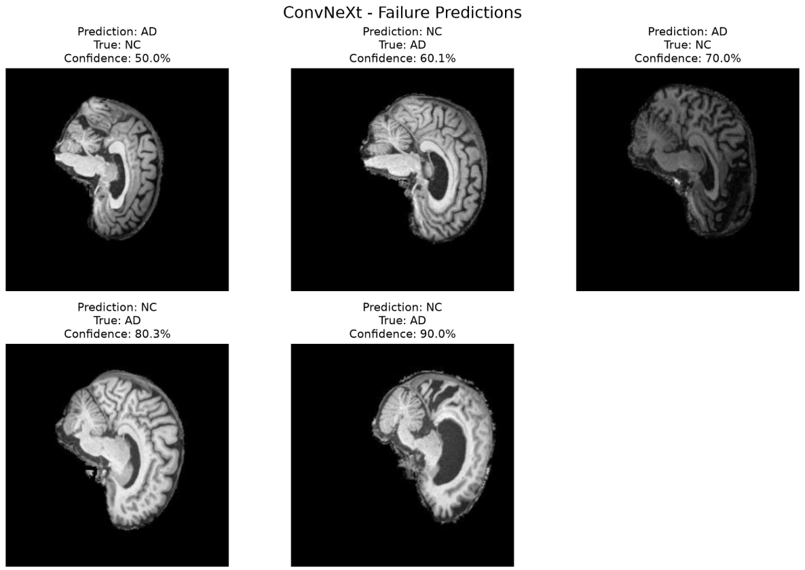  

I have sampled five failure prediction examples from the test set to highlight the limitations of ConvNeXt-Tiny when distinguishing AD from NC cases. These errors suggest that the model may struggle with subtle variations in brain structure and overlapping visual characteristics. I have identified potential root triggers that provide plausible explanations for these misclassifications based on visual inspection.

#### Failure Case 1
Problem: Incorrectly classified NC sample as AD with 50% confidence  
Root Trigger: The image likely contains features that the model associated with AD. Specifically, the brain appears relatively compressed and shows signs of tissue loss on the outer layer of grey matter. The low confidence further suggests that the model was uncertain about its prediction. This highlights a potential limitation of ConvNeXt-Tiny as it may struggle to reliably classify cases when their features appear similar or ambiguous.

#### Failure Case 2
Problem: Incorrectly classified AD sample as NC with 60.1% confidence  
Root Trigger: Based on my nonexpert assessment, the brain appears to retain clearly visible cortical folds and anatomical structures. This may have encouraged the model to associate the image with NC. Therefore, this is a potential limitation of ConvNeXt-Tiny as it may have difficulties identifying subtle AD related changes when the overall brain structure appears preserved.

#### Failure Case 3
Problem: Incorrectly classified NC sample as AD with 70% confidence  
Root Trigger: Misclassification likely occurred due to differences in image contrast. The reduced visibility of the brain structure may have obscured features that ConvNeXt-Tiny relies on to distinguish betweeen AD and NC cases. This relatively high confidence error raises a limitation of the model as its ability to identify AD related changes may be affected by variations in image contrast.

#### Failure Case 4
Problem: Incorrectly classified AD sample as NC with 80.3% confidence  
Root Trigger: Similar to failure case 2, brain's anatomical features are difficult to differentiate from typical NC cases. This may be because the AD related structural changes are subtle which potentially reflect an early stage of the disease. The high confidence in this incorrect prediction raises concerns about the model's ability to reliably identify small or early manifestations of AD.

#### Failure Case 5
Problem: Incorrectly classified AD sample as NC with 90% confidence  
Root Trigger: The model may have focused on strong features associated with NC while failing to detect AD related abnormalities. Specifically, the model may have struggled to recognise the the relevant differences in ventricular size, cortical structure or tissue distribution. The high confidence suggests that ConvNeXt-Tiny may produce overconfident predictions when classifying ambiguous AD cases.

### 7.4 Engineering Recommendation & Trade-off Synthesis
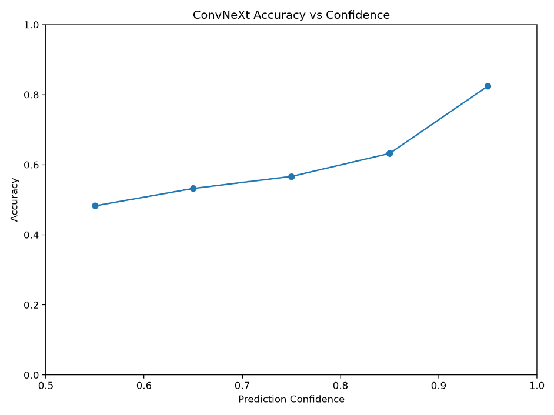

Overall, I recommend ConvNeXt-Tiny as the stronger candidate for future research as it outperformed the baseline CNN across all reported metrics. It is important to note that the test accuracy increased from 72.38% to 78.49% but it did not reach the desired target accuracy of 80%. Although ConvNeXt-Tiny requires signficantly more computational resources to run effectively, I believe the improved classification performance justifies the additional costs. This is an important trade-off in the medical field as the consequences of misclassifications can be signficant. In particular, an ambiguous brain MRI that is incorrectly identified without being flagged for human review may pose greater risks than a routine false positive prediction.

Although ConvNeXt-Tiny performed better, its AD recall of 0.6067 means approximately 0.3933 of actual AD cases are still being missed at the evaluated classification threshold. Its more complex architecture may also increase implementation and maintenance costs. This makes deployment more challenging in resource constrained environments. Therefore, the baseline CNN remains a practical alternative for faster more cost effective experimentations.

From the accuracy vs confidence plot, we can see that accuracy increases as prediction confidence increases. However, the qualitative error autopsies reveal that ConvNeXt-Tiny can still produce highly confident incorrect predictions. This indicates that confidence alone may not be reliable in identifying all ambiguous cases. Therefore, my proposed confidence threshold of 0.8 should be treated as an initial candidate rather than an established reject-option rule. This approach would allow high confidence cases to be automated while routing ambiguous cases to human specialists for further review.

At this stage neither model should be considered suitable for clinical diagnosis. ConvNeXt-Tiny still has limited AD recall and its robustness across different patients has not been established. Therefore, I recommend conducting further threshold validation, hyperparameter optimisation and model evaluation before considering any practical deployment. This allows the current project to build on ConvNeXt-Tiny's improved performance while addressing the remaining reliability and resource constraints.

### 7.5 Limitations & Future Improvements
#### Current Limitations:
1. **High False-negative Rate for AD:** The model misclassifies a significant number of AD case as NC. False negatives may result in potentially concerning cases being overlooked.  
2. **Overfitting:** The model achieves high training performance while test performance is lower. This indicates the model may be learning patterns specific to the training data instead of generalising to unseen patients.
3. **Overconfident Predictions:** High classification accuracy does not guarantee reliable predictions on ambiguous cases. The model can still produce confident predictions that are incorrect. This limits the reliability of confidence scores as an indicator of diagnostic certainty.
4. **Computational Requirements:** Training ConvNeXt requires access to GPU resources on the Rangpur HPC cluster. This creates a dependency on the availability of resources and limits how easily the system can be trained.
5. **Limited Dataset Representation:** The model is trained and evaluated on the available ADNI dataset so its performance may not generalise to overall MRI data.
6. **2D Image Approach:** The model processes individual MRI slices rather than the complete 3D brain. This may cause useful spatial information between slices to be lost.

#### Future Improvements:
1. **Address Class Specific Errors:** Investigate methods for reducing the high false-negative rate for AD such as class weighted loss functions, focal loss or adjusting the classification decision threshold.
2. **Further Hyperparameter Tuning:** Experiment with different hyperparameters such as learning rate, weight decay, scheduler settings and augmentation strength.
3. **Explore MixUp and CutMix:** Introduce additional augmentation techniques such as MixUp and CutMix to increase training diversity and potentially improve generalisation.
4. **Investigate Other ConvNeXt Variants and Models:** Compare the performance of different ConvNeXt variants and other modern image classification models such as Swin Transformers or EfficientNet.
5. **3D or Multi-slice Modelling:** Process multiple MRI slices jointly or use a 3D model architecture to preserve spatial information across the brain.
6. **Reduce Computational Requirements:** Investigate model compression, transfer learning or mixed precision to reduce training and inference costs.


## 8. Artificial Intelligence Usage Disclosure
I used Artificial Intelligence models as supplementary development and research tools during this project. However, I treated AI generated suggestions as recommendations rather than authoritative solutions.

#### **AI Tools Used:**
- ChatGPT was used to assist with understanding ConvNeXt architecture and debugging implementation issues. It also suggested refactoring to improve code structure and helped interpret error messages encountered during development.
- Codex was used to assist with specific code development and implementation. Specifically, it was used for scaffolding the data loading, training and evaluation functions.

I manually reviewed all AI assisted code before incorporating it into the project. I did not blindly assume AI generated code was correct and developed corresponding test suites within the actual project environment. Where AI suggestions produced incorrect or unsuitable code, I corrected the implementation manually. The final evaluation about the ConvNeXt model was based on the project's own experimental results rather than AI generated claims.


## 9. References
[1] World Health Organisation. (2026, July 3). Dementia. Retrieved from who.int: https://www.who.int/news-room/fact-sheets/detail/dementia  
[2] Zhuang Liu, H. M.-Y. (2022, January 10). A ConvNet for the 2020s. Retrieved from arxiv.org: https://arxiv.org/pdf/2201.03545
[3] GeeksforGeeks. (2025, July 15). ConvNeXt. Retrieved from geeksforgeeks.org: https://www.geeksforgeeks.org/computer-vision/convnext/  
[4] Zhuang Liu, H. M.-Y. (2022, January). ConvNeXt. Retrieved from github.com: https://github.com/facebookresearch/ConvNeXt  
[5] ApX Machine Learning. (2026). Common Split Ratios. Retrieved from apxml.com: https://apxml.com/courses/basics-model-evaluation-metrics/chapter-4-preparing-data-evaluation/common-split-ratios  
[6] Stewart, M. (2019, July 9). Simple Guide to Hyperparameter Tuning in Neural Networks. Retrieved from medium.com: https://medium.com/data-science/simple-guide-to-hyperparameter-tuning-in-neural-networks-3fe03dad8594  
[7] Budu, E. (2025, February 28). Common Causes of NaNs During Training. Retrieved from baeldung.com: https://www.baeldung.com/cs/ml-training-nan-errors-fix  
[8] beaupreda. (2019, November). Validation loss goes high with validation accuracy. Retrieved from discuss.pytorch.org: https://discuss.pytorch.org/t/validation-loss-goes-high-with-validation-accuracy/60412  
[9] Narayanan, D. (2026, March 7). Popular Optimizers Used in Deep Learning Models. Retrieved from medium.com: https://medium.com/@devibala2411/popular-optimizers-used-in-deep-learning-models-637e6daaf683  